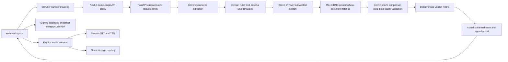

# Nivaar architecture

A desktop-first Next.js frontend and FastAPI backend, packaged in one Docker service for Render. The public Node server listens on Render's `PORT`; FastAPI listens only on container loopback port 8000. Next.js rewrites same-origin `/api/*` requests to FastAPI. There is no ChatGPT/Sites authentication or Worker runtime.

## Provider adapters and failure states

`llm_client.py` supports Gemini, OpenAI structured JSON, and Groq JSON mode with Pydantic validation. User-selected Gemini is the default. LLMs extract claims and compare quotes; they never emit the final verdict. The final summary, next steps and complaint templates are deterministic and localized in EN/HI/KN.

Brave/Tavily are queried using redacted pattern queries and site restrictions. Results are rechecked against the official-domain allowlist. Search snippets are not evidence. Missing keys or quota failures fall back to deterministic extraction and the registry and are marked in trace/limitations. `REQUIRE_LIVE_PROVIDERS=true` rejects analysis if the AI key is absent, instead of silently offering an apparently complete product.

Sarvam provides actual server-to-provider speech endpoints. Local browser OCR and browser dictation/read-aloud remain explicit fallbacks. Cloud images and audio require consent. No API key is embedded in frontend assets. The speech REST adapter targets short clips; the recorder stops at 30 seconds and the provider enforces its supported formats/duration.

## Evidence, URL and decision boundaries

Submitted links are inspected as strings, never directly fetched. Official document fetches require allowlisted HTTPS hosts, public DNS answers, a pinned IP with the original Host/TLS SNI name, revalidation on every redirect, a 14-second total timeout, a three-request redirect bound and a 2 MB decoded-body limit. HTML and PDF are parsed into normalized text. Evidence includes a text hash and UTC retrieval time. Source failures remain failures.

AI claim/source matches must reference known IDs and quote an exact passage from a fetched document. Unmatched quotes are discarded. Every material extracted claim must be supported to verify authority. GENUINE additionally requires a matching official reference supplied with the message; public documents cannot verify private account, application, payment or delivery events. This guard was added after a live Hindi ambiguous-notice regression exposed overly optimistic evidence matching. This constrains hallucinations but is not a proof that model interpretation or claim completeness is correct. Source cards show the quote for user inspection. Without AI, only exact document-text coverage or the explicitly matched recruitment denial can establish authority; there is no one-string demo acceptance rule.

Dangerous action, dangerous destination or an officially contradicted claim yields SCAM. GENUINE requires corroborated authority, no suspicious/dangerous action or destination, and no high-risk tactics. Everything else is UNSURE. Matching content never authenticates a sender.

## Reports and privacy

Messages and uploads are not stored in a database. Recent checks remain only in page memory. Uploaded media is kept only for the request and sent to a provider only after consent; provider retention policies still apply. Redaction masks number patterns, not all personal data.

A report hash covers canonical sorted UTF-8 JSON with an empty `report_hash` field. The backend signs that hash using an HMAC server secret. PDF download submits the exact report and signature, verifies both the hash and HMAC, and renders that snapshot without re-running providers. ReportLab uses a bundled, openly licensed font for Latin, Hindi and Kannada shaping. PDF and JSON endpoints are not legal certification.

## Deployment and operational limits

One supervised Node process launches FastAPI and Next.js and terminates both if either exits. Render uses the root Dockerfile and render.yaml. Secrets are runtime environment variables. Liveness `/api/health` is separate from provider-presence `/api/ready` and explicit live smoke tests.

Request limits, a process-wide rate limit and investigation concurrency bounds protect upstream costs. These limits are designed for a single Render instance and do not replace a distributed limiter for multi-instance deployments. The benchmark requires a separate access token in production. Files are not persisted. Family guardian links and live-call co-pilot were excluded by the reduced master brief and remain outside this implementation.
