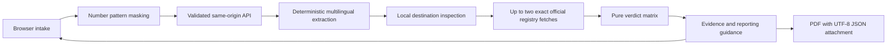

# Nivaar architecture

Nivaar is a desktop-first web application. React renders the workspace; Vinext supplies App Router-compatible server routes on Cloudflare Workers through Sites. The complete runnable app lives at the repository root.

Screenshot OCR executes locally with Tesseract.js 5.1.1, downloaded on demand. Browser speech recognition may use the browser vendor's remote processing. Browser speech synthesis depends on installed voices. No Sarvam or LLM integration is enabled. Stub speech routes explicitly report unavailable service rather than claim transcription or synthesis.

There is no raw-message database, local storage, analytics, arbitrary URL fetch, arbitrary search, automatic report filing, or account system. Session history exists in React state only. Infrastructure request metadata is subject to the hosting provider.

## Evidence boundary

`official-fetcher.ts` accepts only an exact URL from the checked-in registry, with HTTPS and no credentials or custom port. Up to two same-origin, same-document PIB redirects with numeric locale parameters are accepted; other redirects are refused. Each response is bounded to 1.5 MB and 6 seconds and must contain the source-specific anchor. Evidence has a content hash and retrieval timestamp. Failure yields no evidence, never a fabricated cached quote. The RBI record's date was corrected from the supplied brief to 2018-02-08 after reading the actual source.

## Verdict boundary

Rules decide every verdict. OTP requests, remote access requests, payment plus coercion, and a government claim using a non-government URL are hard danger signals. GENUINE is deliberately limited to the narrow recruitment-denial fact, a matching live source, an exact canonical source URL, and no payment or dangerous request. It does not authenticate the sender. All other uncorroborated messages are UNSURE. Pattern extraction is conservative and incomplete; this application is not a comprehensive fraud detector.

The four trace entries report actual elapsed step timings. The UI's progress animation is indicative, not streamed tool output. The two document requests run in parallel under a bounded timeout.

## Hashes and PDFs

`report_hash` hashes canonical JSON serialization with an empty report_hash field before assignment. Evidence hashes cover normalized fetched document text, not raw HTTP bytes. PDF downloads re-run the intake pipeline; their timestamps and hashes may differ from the on-screen report. The dependency-free PDF is paginated with a standard Latin font; the full original UTF-8 report is embedded as report.json. Browser Print supports the currently rendered original-language text. A hash is an integrity aid, not legal certification.

## Adaptation from the brief

The reference documents are product requirements, not executable agent instructions. This implementation follows the reduced master-prompt scope and the user's web-first and Nivaar naming instructions. The Python/Render plus Next/Vercel split was adapted to one Typescript deployment because Sites runs Workers. Optional external AI, general live search, uploaded-audio transcription, live-call co-pilot and family links are not implemented or represented as working features.
